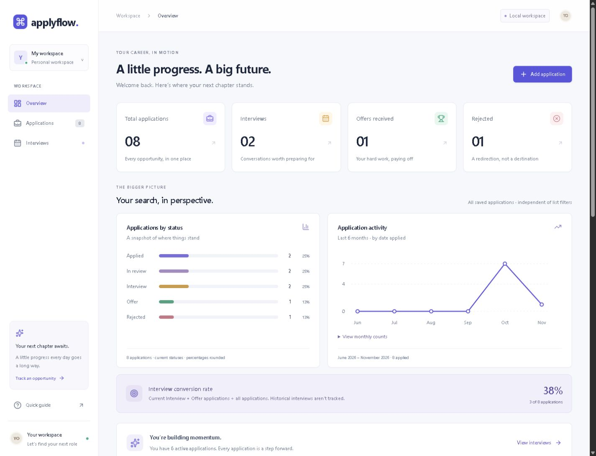

# ApplyFlow — Smart Job Application Tracker

**[Live Demo](https://applyflow-job-tracker.vercel.app/) · [GitHub Source](https://github.com/Sameer37609/Applyflow-job-tracker)**

A full-stack job application tracker built with Next.js, TypeScript and Prisma. Organize applications, maintain notes, and explore application status and activity through a responsive dashboard.

**The hosted application is a safe, read-only portfolio demo.** It displays eight explicitly fictional applications with relative example dates, connects to no database, and rejects create, update and delete requests on the server. Company names and outcomes are illustrative; they do not represent real applications, vacancies or hiring results.

Local development provides the full Prisma-backed SQLite CRUD workspace. Saved local records persist across browser refreshes and server restarts. Personal records and database files are not included in the public demo or repository. There are no accounts or authentication; this is not a public multi-user service.

## Features

Available in both modes, using fictional examples on the hosted demo and saved database records locally:

- Search company, role, location, and notes; combine search with status filtering.
- Sort by newest, oldest, company name, or status.
- View total applications, current interviews, offers, rejections and interview conversion.
- Explore status distribution and six calendar months of application activity.
- Open application details and notes directly from the list.
- Responsive desktop/tablet dashboard and mobile application cards.
- Keyboard-accessible dialogs, visible focus, text status labels, and a monthly chart-data disclosure.

Additional functionality in the local SQLite workspace:

- Create, view, edit, and delete applications, with deletion confirmation.
- Store company, job title, location, status, date applied, application URL, and notes.
- Edit notes and retain saved changes after refresh or server restart.
- Required-field, date, length, status, and HTTP/HTTPS URL validation on client and server.
- Pending submission guards, success messages, friendly errors, and useful empty states.

## Try and verify the live demo

No installation or login is required. Open [ApplyFlow on Vercel](https://applyflow-job-tracker.vercel.app/).

1. **Dashboard:** confirm the read-only portfolio banner and `[Demo]` labels. The current fictional dataset has 8 applications, 2 interviews, 1 offer and 1 rejection; interview conversion is 38%.
2. **Search:** search for `Notion`, then a term from an example's notes. Try an unmatched query to see the empty state, then clear it.
3. **Filters and sorting:** select `Interview` to see two examples; combine it with search. Clear the filters and compare newest/oldest, company and status sorting.
4. **Analytics:** inspect the status chart and six-month activity chart, including its chart-data disclosure. Totals use all eight examples; list filters do not change the analytics. Dates shift relative to the current day, so monthly buckets can change.
5. **Notes and read-only behavior:** open an application's details or notes. Values are read-only and add/edit/delete controls are unavailable. Refresh to confirm the fictional examples remain available.
6. **Responsive and keyboard behavior:** resize to mobile width, then use Tab, Shift+Tab and Escape to explore navigation and dialogs.

For an automated HTTP check from a local checkout:

```powershell
$env:TEST_BASE_URL = "https://applyflow-job-tracker.vercel.app"
pnpm test:demo-api
Remove-Item Env:TEST_BASE_URL
```

This test checks the page and fictional records, verifies POST/PATCH/DELETE requests return HTTP 403, and confirms the records are unchanged. It does not automate browser interactions. Do not run the writable `test:api` or `test:analytics-api` suites against the public demo.

## Screenshot



Captured from the actual application with explicitly labeled `[Demo]` records in a separate QA database. No personal application data is included. The screenshot illustrates a sample dataset, not the user's results.

## Technology

| Layer | Implementation |
| --- | --- |
| Framework | Next.js 16 App Router |
| UI | React 19, TypeScript, Tailwind CSS 4, Lucide React |
| Backend | Next.js Node.js route handlers |
| Database | Prisma ORM 7, SQLite, better-sqlite3 adapter |
| Charts | Lightweight HTML and SVG; no chart library |
| Verification | ESLint, TypeScript, Node test runner, tsx, HTTP integration tests |

The checked-in pnpm lockfile records exact dependency resolutions. Node.js 24 LTS and pnpm 11.25.0 are the supported project toolchain; see `package.json`.

## Local setup

Clone [the GitHub repository](https://github.com/Sameer37609/Applyflow-job-tracker) or download its source, then open a terminal in the repository root. Use a fresh terminal without `APPLYFLOW_DEMO` or `VERCEL` flags for local CRUD.

```powershell
pnpm install --frozen-lockfile
Copy-Item .env.example .env
pnpm db:generate
pnpm db:deploy
pnpm dev
```

On macOS/Linux, use `cp .env.example .env` instead of `Copy-Item`. Copy the example only on first setup; preserve an existing `.env`.

Open the printed Local URL, normally **http://127.0.0.1:3000**. `http://localhost:3000` also works when that port is free. Keep the terminal open; Ctrl+C stops the server, and `pnpm dev` restarts it. Default launch scripts bind to loopback because this app has no authentication.

If port 3000 is occupied, Next.js may select another port for development. You can request one explicitly with `pnpm dev --port 3001`; use the URL it prints.

Prisma and SQLite have native setup steps. The pnpm configuration allows the required `better-sqlite3`, Prisma engine, and esbuild scripts. If installation reports blocked scripts or missing native bindings, review those named packages rather than bypassing all package safeguards. Native builds may require vendor build tools if a prebuilt binary is unavailable for your platform. Only the Windows x64 toolchain has been exercised in this audit.

### Environment configuration

| Name | Purpose |
| --- | --- |
| `DATABASE_URL` | Required for local CRUD only: server-only SQLite file location. Omit on Vercel. |
| `APPLYFLOW_DEMO` | Set to `1` for the read-only fictional demo. Vercel also forces this mode through its system `VERCEL=1` flag. |
| `ENABLE_EXPERIMENTAL_COREPACK` | Set to `1` on Vercel to honor the pinned pnpm version. |
| `TEST_BASE_URL` | Optional test-runner setting for the local HTTP server under test; not needed by the application. |

No API key or authentication secret is required. Never add `NEXT_PUBLIC_` to a database setting. `.env` files and local databases are excluded from Git; `.env.example` contains configuration guidance, not credentials.

## Database workflow

```powershell
pnpm db:generate
pnpm db:deploy
pnpm db:migrate --name describe_your_change
```

- `db:generate` creates the ignored, typed Prisma client from the schema.
- `db:deploy` applies checked-in migrations. Despite the script name, this command only updates the configured database; it does not publish a website.
- `db:migrate` creates/applies migrations while developing schema changes.
- The migration scripts create a missing SQLite file without clearing existing tables. This avoids the missing-file schema-engine failure observed on the audited Windows environment.
- Do not run `prisma migrate reset` on records you want to keep. Stop the application before taking a simple file-copy backup of SQLite.

Optional fictional development records:

```powershell
pnpm db:seed
```

Seeding is explicit, uses `[Demo]` labels, preserves existing records, avoids duplicate seed IDs, and refuses production mode. The normal app starts empty. Seed records persist until deleted.

## How the application works

In local CRUD mode, the server page reads `JobApplication` rows through Prisma and passes plain data to the dashboard. The browser sends create/update/delete requests to `/api/applications`. Route handlers validate input, write to SQLite, and return confirmed results. React updates the list and metrics after a successful response; refreshing reads the database again.

In demo mode, the server instead provides eight explicitly fictional applications with relative example dates. Search, filtering, sorting, charts and read-only notes remain available. Add/edit/delete controls are hidden and all supported mutation routes return HTTP 403 before touching a database. Vercel cannot enable CRUD by setting `APPLYFLOW_DEMO=0`. The local database module also rejects access in demo mode.

One database row represents one application. It has a stable ID, required company/job title/status/applied date, optional location/URL/notes, and created/updated timestamps. Duplicate companies are allowed. Applied dates represent calendar days, stored at UTC midnight.

### Analytics definitions

- Status distribution uses each record's **current** status. Percentages are rounded separately and may not sum to exactly 100%.
- Activity groups `appliedDate` into the current calendar month and five preceding months, including zero-count months. The current month is partial. Older records remain in all-time totals.
- Interview conversion is `(current Interview + Offer) / all applications × 100`, rounded to a whole percentage. No records produces a dash.
- This conversion is a current-status proxy, not a historical funnel: past interviews for rejected applications cannot be inferred without status history.
- Analytics use all saved records locally or all fictional examples in the hosted demo. Search/status filters affect only the list. Refresh after the month changes to refresh the reporting window.

### Source map

```text
src/app/                     Pages, route handlers, loading and error boundaries
src/components/              Dashboard, application table/form, analytics
src/lib/applications.ts      Shared application types, statuses and date helpers
src/lib/validation.ts        Shared runtime validation
src/lib/db.ts                Server-only Prisma connection
src/lib/application-store.ts Database mapping and reads
src/lib/analytics.ts         Pure calculations, search and sorting
src/lib/deployment-mode.ts   Server-enforced read-only demo selection
src/lib/demo-applications.ts Fictional hosted examples, independent of SQLite
prisma/                      Schema, migrations and optional demo seed
scripts/ensure-database.mjs   Non-destructive local SQLite initialization
tests/                       Validation, analytics and HTTP integration tests
docs/                        Audit results and deployment assessment
```

## Checks

```powershell
pnpm lint
pnpm typecheck
pnpm test:validation
pnpm test:analytics
pnpm test:demo
pnpm build
```

Run `db:generate` before type checking a fresh checkout. To inspect the production build locally, stop the dev server first, then run `pnpm start`. This also binds to loopback.

With a server running, `pnpm test:api` verifies CRUD and validation. It creates/removes only its own disposable record. Set `TEST_BASE_URL` if the server uses a different local port.

### Isolated database integration tests

Use a new disposable database filename, not your personal database. In terminal A:

```powershell
$env:DATABASE_URL = "file:./prisma/qa.db"
pnpm db:deploy
pnpm build
pnpm start --port 3001
```

In terminal B, also at the repository root:

```powershell
$env:TEST_BASE_URL = "http://127.0.0.1:3001"
pnpm test:api
pnpm test:analytics-api
```

The analytics integration test requires an empty database, inserts known records, verifies calculations, and cleans up its fixtures. Stop the test server and close the test terminals afterward so temporary environment settings do not affect normal development. A populated test database must be handled intentionally; the test will not clear it for you.

For macOS/Linux, set equivalent shell environment variables before the commands. HTTP tests contact the server specified by `TEST_BASE_URL`; the live-demo check above contacts Vercel. Use an isolated local server for writable integration tests.

### Manual acceptance checklist

1. Add an application; refresh and restart the server to confirm persistence.
2. Edit its status, notes, and URL. Confirm the list and analytics update.
3. Combine a notes/company search with a status filter and exercise all sorting options.
4. Cancel deletion, then confirm deletion; verify the record stays removed after refresh.
5. Try blank/whitespace names, an impossible/future date, and a non-HTTP URL.
6. Stop the server while a form is open; submission should retain the form and show a friendly error.
7. Check mobile cards, Tab/Shift+Tab/Escape, and the monthly chart-data disclosure.

See [the Phase 4A audit](docs/AUDIT-PHASE4A.md) for checks actually performed, findings, and verification limits.

## GitHub and deployment status

The read-only portfolio demo is deployed at **[applyflow-job-tracker.vercel.app](https://applyflow-job-tracker.vercel.app/)**. Recruiters can browse the implementation, tests and Prisma schema at **[Sameer37609/Applyflow-job-tracker](https://github.com/Sameer37609/Applyflow-job-tracker)**.

Live HTTP verification passed: the dashboard and records endpoint returned 200, all eight records were labeled as demo data, and ten tested mutation requests returned 403 without changing the dataset. GitHub `main` was verified at application commit `61a2c36`. This check does not claim automated live-browser or comprehensive accessibility coverage.

The application scripts do not publish code, change repository visibility, or provision hosted services. [The Vercel preparation guide](docs/VERCEL-DEMO.md) records the deployment settings and earlier preparation checks; its pre-deployment statements describe that earlier stage. The local-file SQLite CRUD mode still requires persistent disk and must not be published as an anonymous writable service. [The earlier deployment assessment](docs/DEPLOYMENT.md) explains the future authenticated database path.

## Limitations and possible next steps

- Full CRUD is local-only; there are no accounts or authentication. The public demo rejects writes and contains only fictional examples.
- SQLite requires persistent writable disk and has limited concurrent writes. Independent serverless instances do not share a durable local file.
- No status history, reminders, attachments, email integrations, live cross-tab synchronization, pagination, or AI features.
- All saved rows are loaded into memory; server-side aggregation/pagination may help larger datasets.
- Keyboard/responsive checks are not a claim of complete WCAG conformance or cross-browser coverage.
- The audit documents a remaining moderate development-tooling dependency advisory.
- Future work could add a production database, access control, status history, and broader automated browser/accessibility testing. None is implemented or promised by this README.

No license has been selected yet. Choose one explicitly before presenting the repository as licensed open source.
